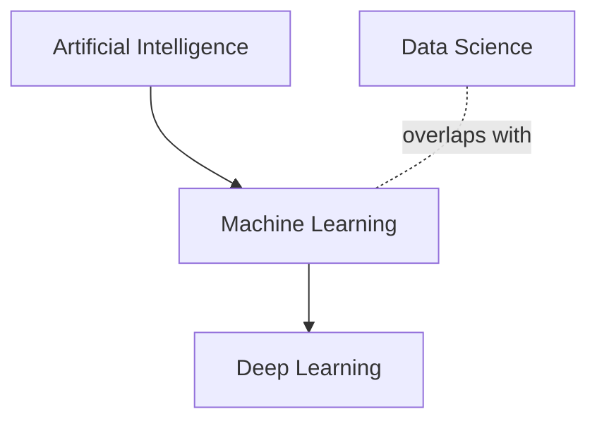

# Lesson 00.1 — AI, Machine Learning, Deep Learning and Data Science

## 1. Start with the question
How could a computer help sort spam email, predict house prices, recommend a movie or group customers? Some systems use rules written by people. Others learn patterns from examples. These ideas are related, but the names are not interchangeable.

## 2. Simple definitions
- **Artificial Intelligence (AI):** the broad field of building systems that perform tasks associated with intelligent behaviour, such as planning, perception, language or decision support.
- **Machine Learning (ML):** a part of AI in which a system fits patterns from data to make predictions or decisions, instead of requiring every rule to be written manually.
- **Deep Learning (DL):** a part of ML that uses neural networks with multiple layers to learn representations. It is especially important in modern image, audio and language systems, but it is not the whole of ML.
- **Data Science:** work that uses data, statistics, programming and domain knowledge to answer questions and support decisions. It may use ML, but not every data-science task requires a trained model.



The diagram is a simplified way to remember the relationship. Data Science overlaps with ML rather than being a strict child box inside it.

## 3. Traditional programming vs learning from data

**Rule-based programming:** people write the decision rules and the computer applies them.

Example: label a message as “long” if its character count is greater than 200. The programmer specifies the rule.

```python
message = "Please call me when you arrive."
if len(message) > 200:
    label = "long"
else:
    label = "short"
print(label)
```

**Output**
```text
short
```

For a clear rule such as this, ordinary programming is appropriate. ML is not needed.

For spam filtering, people might try to write thousands of rules. Spam patterns change, and rules are difficult to maintain. With a labelled dataset of emails, an ML algorithm can fit a model that uses patterns in message features to predict whether a new email is spam. It still needs data, decisions, testing and maintenance.

## 4. One task, two approaches
Task: estimate a house's sale price from its size.

A simple rule-based baseline might be: price = area × a fixed price per square metre. This is easy to understand, but assumes the rate is known and constant.

An ML approach uses historic examples with both area and final sale price. A training algorithm selects model parameters that reduce prediction error on those examples. The learned relationship can then make estimates for new houses. Other features such as location and age may matter too.

**Important:** the model learns associations from recorded data. If the training prices are biased, stale or unrepresentative, the predictions can inherit those problems.

## 5. Common misconceptions
- **“AI and ML are the same.”** ML is one approach within AI; AI also includes rule-based and search/planning systems.
- **“Deep learning is always better.”** It may need more data, compute and tuning. A simple model can be easier to interpret and sufficient for the task.
- **“Data Science always uses ML.”** Data exploration, reporting, experiments and statistical analysis can be valuable without training a predictive model.
- **“ML removes the need for domain knowledge.”** Domain knowledge helps define targets, detect leakage, assess data quality and interpret failures.
- **“A good metric proves a model is safe.”** Evaluation must match the real task and account for failure costs, distribution changes, and fairness or safety needs.

## Practice
1. **Basic:** Is a fixed if/else rule automatically Machine Learning?
2. **Basic:** Is every neural network a deep-learning approach? Not every neural network must be deep; Deep Learning commonly refers to multi-layer neural networks.
3. **Implementation:** Change the rule-based message example to classify text as “empty” if it contains no non-space characters. Does that require ML?
4. **Reasoning:** A model has 99% accuracy on yesterday's data, but the input distribution changes this year. What should you question?

**Answers**
1. No. A manually written rule is traditional rule-based programming.
2. No; depth matters, and terminology can depend on architecture/context.
3. No. A simple string rule is enough.
4. Check whether the test data represents current use, assess distribution drift, and re-evaluate on suitable recent data. Past accuracy is not a guarantee.

## Connection to the next lesson
We know the broad field names. Next, define the pieces of a prediction problem precisely: samples, features, targets, model parameters, training and inference.
