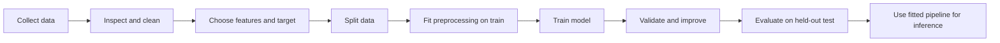

# Lesson 00.2 — Dataset, Features, Target, Model, Training and Inference

## 1. Begin with a tiny table

Suppose we have records of houses:

| Sample | Area (m²) | Bedrooms | Sale price (thousand currency units) |
|---|---:|---:|---:|
| A | 50 | 1 | 120 |
| B | 70 | 2 | 165 |
| C | 90 | 3 | 215 |
| D | 110 | 3 | 250 |

Each row is a **sample** (or observation). The complete table is a **dataset**. Area and bedrooms are **features**—the inputs that might help predict the answer. Sale price is the **target** or **label** we want to predict.

In common scikit-learn notation, feature inputs are written X and target values y. Uppercase X often represents a matrix with rows for samples and columns for features; lowercase y often represents one target value per sample.

## 2. The main words

- **Algorithm:** the procedure used to fit a model from training data.
- **Model:** the fitted relationship or mapping used to convert inputs into predictions.
- **Training:** using training examples to estimate model parameters.
- **Parameter:** a value learned during fitting, such as the slope and intercept of a linear model.
- **Hyperparameter:** a setting selected outside the model's ordinary fitting step, such as the maximum depth of a decision tree.
- **Inference/prediction:** applying the fitted model to new inputs.
- **Loss:** a numerical measure of how bad a prediction is under a chosen rule.
- **Generalisation:** how well the model works on relevant examples it did not train on.

The words “algorithm” and “model” are related but different. The algorithm is the method used to learn; the model is the result used later for prediction.

## 3. A complete high-level pipeline



In a valid process, the held-out test set should not repeatedly guide feature or hyperparameter choices. Doing so indirectly turns it into another validation set and gives an overly optimistic final score.

## 4. Supervised, unsupervised and reinforcement learning
- **Supervised learning:** training examples include the target. Examples: predicting a numeric house price (regression), or classifying a message as spam/not spam (classification).
- **Unsupervised learning:** there is no supplied target label; the goal is to explore structure such as clusters or lower-dimensional representations.
- **Reinforcement learning:** an agent learns behaviour by interacting with an environment and receiving rewards or penalties. This is a different setup from the ordinary labelled-table examples in this course.

## 5. Regression, classification and clustering
| Task | Output idea | Example |
|---|---|---|
| Regression | Number on a numeric scale | House price |
| Classification | One of defined categories, optionally with probabilities | Spam vs not spam |
| Clustering | Groups inferred from similarities without target labels | Customer segments |

A classification model might output a probability such as 0.82 for “spam”; a threshold or decision policy is then used to assign a category. A clustering algorithm does not automatically reveal true human categories—the groups need interpretation and validation.

## 6. A tiny Python representation

```python
# One row is one sample; each sample has two input features.
X = [
    [50, 1],
    [70, 2],
    [90, 3],
]
y = [120, 165, 215]  # target value for each sample

print("Samples:", len(X))
print("Features in first sample:", len(X[0]))
print("First input row:", X[0])
print("First target:", y[0])
```

**Output**
```text
Samples: 3
Features in first sample: 2
First input row: [50, 1]
First target: 120
```

This is just ordinary Python data. No model has been trained yet. X holds the input features; y holds known target values. A learning algorithm will be introduced later.

## 7. Questions a beginner might ask
**Q: Are features always numeric?**  
Not necessarily. Real datasets can include categories, text, dates and images. Many algorithms need these inputs to be converted into suitable numerical representations first.

**Q: Can the target also be a feature?**  
It can exist as a column in the original table, but it must not be included among predictors in a way that leaks the answer into the model. In supervised learning, we usually separate the chosen target as y.

**Q: Why split the dataset?**  
A model can memorise training examples or exploit accidental patterns. Evaluation on held-out samples gives evidence about performance on unseen data.

**Q: Are hyperparameters learned from the training examples?**  
The fitting algorithm learns model parameters. Hyperparameters are chosen through a development procedure (often validation/cross-validation); the distinction is conceptual, although library implementations may have more details.

## Practice
1. Mark which column is the target in the house table.
2. Is “customer segment” a regression target, classification target, or a clustering goal when no labels are provided?
3. Explain algorithm vs model using the example of learning a relationship between house area and sale price.
4. Why should model selection not repeatedly use the final test set?

**Answers:** Sale price is target; unlabeled customer grouping is clustering; the algorithm fits the relationship and the fitted relationship is the model; repeated test-set choices leak evaluation information into development decisions.

## Connection to the next lesson
Next, combine the vocabulary in a tiny prediction example and carefully distinguish a hand-written rule from a learned model.
