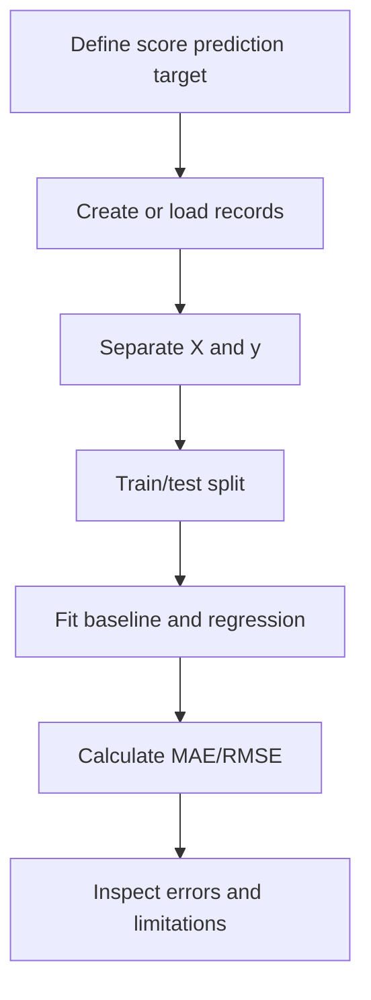

# Project 1 — Student Performance Prediction

**Task:** regression. **Skills:** Pandas, train/test split, baseline, LinearRegression, MAE/RMSE.

## Problem statement
Predict a numeric exam score using inputs recorded before the exam, such as practice questions completed and prior score. The data is synthetic for learning; it must not be used to judge real students or make educational decisions.

## Feature and target design
- practice_questions: number of practice questions recorded before the exam.
- previous_score: prior assessment score.
- target final_score: next assessment score.

The final score is not included in X. This is a small demonstration of the feature/target distinction and a leakage-safe split, not a causal study.

## Run
Install: python -m pip install numpy pandas scikit-learn  
Run: python student_performance.py

## Complete code
See [student_performance.py](student_performance.py). It creates a reproducible synthetic dataset, separates X and y, makes a train/test split, fits a mean baseline and a linear regression, then evaluates with MAE and RMSE.

## Expected behaviour
The script prints sample count, baseline error and model error. Scores are calculated at runtime; do not assume the model must beat the baseline on every possible synthetic dataset. The script fixes the random seed for repeatability.

## Class relationship / flow

## Test checklist
- Verify no final_score field exists in the feature matrix.
- Confirm every sample has a target.
- Re-run with a different random seed and observe score variability.
- Compare a baseline with the model using the same split.
- Inspect whether the learned relationship makes sense.

## Interview questions
1. Why is the task regression rather than classification?
2. Why must the target be excluded from X?
3. Why compare against a dummy baseline?
4. What does MAE mean in score points?
5. What would you do if validation error is much larger than training error?

**Limitations and extensions:** synthetic data is not representative evidence. Add a carefully licensed public dataset, document how features were collected, test subgroup errors, and avoid interpreting predictions as causes or labels of student ability.
