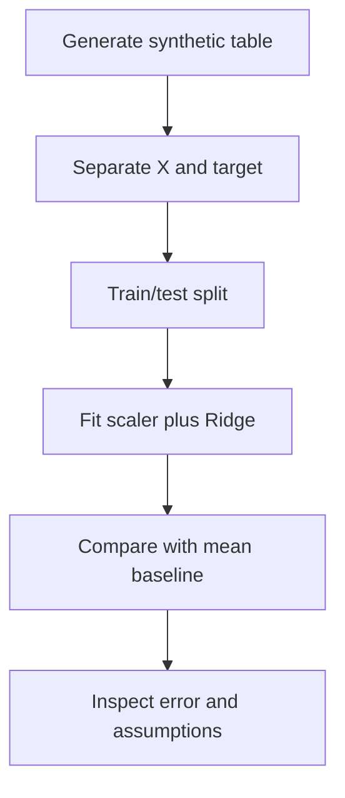

# Project 2 — House Price Prediction

**Task:** regression. **Skills:** multiple features, Ridge, scaling, MAE/RMSE and residual analysis.

## Problem statement
Estimate a synthetic house price using area, bedrooms and age. The generated values imitate a simple numeric relationship and are not a real market dataset. They should never be used to estimate actual property value.

## Pipeline

## Run
Install: python -m pip install numpy pandas scikit-learn  
Run: python house_price.py

## Complete code
The accompanying script creates data with a fixed seed, splits it, compares a baseline to a Ridge model, and reports MAE/RMSE. It fits the scaler inside a Pipeline and only on training data.

## Key questions
1. Why is multiple linear regression appropriate as a baseline?
2. Why can correlation among area and bedrooms complicate coefficient interpretation?
3. Why keep scaling inside the pipeline?
4. What assumptions make this synthetic dataset unlike real housing data?
5. How would you test generalisation to a new city or a future year?

## Extensions
- Add a categorical location feature and one-hot encode it in a ColumnTransformer.
- Plot predicted vs true values and residuals.
- Use cross-validation to tune Ridge alpha.
- Document that market values change over time and this toy dataset has no external validity.
