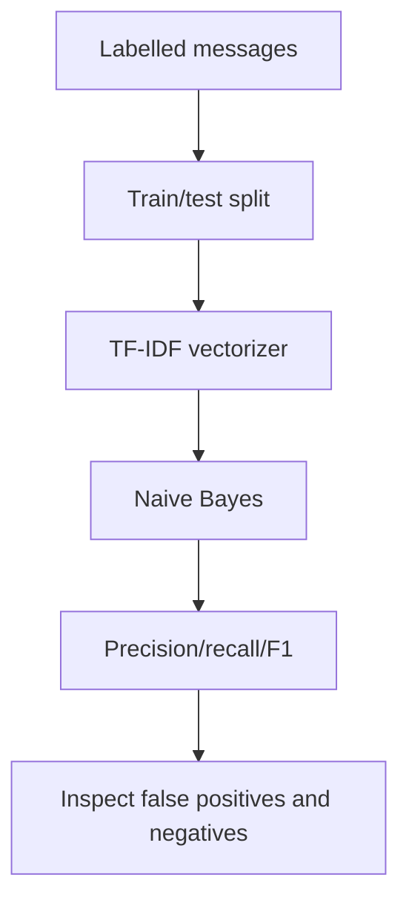

# Project 3 — Spam Message Classification

**Task:** text classification. **Skills:** train/test split, TF-IDF, Naive Bayes, precision, recall and data leakage.

## Problem statement
Classify a short message as spam or normal using labelled examples. The built-in sample is intentionally tiny and synthetic; it only demonstrates the shape of a text pipeline, not a useful spam detector.

## Why split first?
A text vectoriser learns a vocabulary and inverse-document-frequency values from the training text. If it is fitted before splitting, the test messages have influenced preprocessing. Put vectorisation and classifier inside one Pipeline so cross-validation and fit only learn transformations from the training fold.

## Run
Install: python -m pip install scikit-learn  
Run: python spam_classifier.py

## Workflow

## Interview questions
1. Why does the pipeline need both vectorizer and classifier?
2. What information does TF-IDF capture?
3. Why can a high accuracy be misleading if spam prevalence is low?
4. Why is the tiny example not fit for deployment?
5. What error is more costly in your application: blocking a legitimate message or missing spam?

## Extensions
- Replace the tiny sample with a documented, legally appropriate public dataset.
- Compare MultinomialNB and LogisticRegression using the same CV setup.
- Inspect false positives and false negatives.
- Keep duplicate/near-duplicate messages from appearing across train and test.
