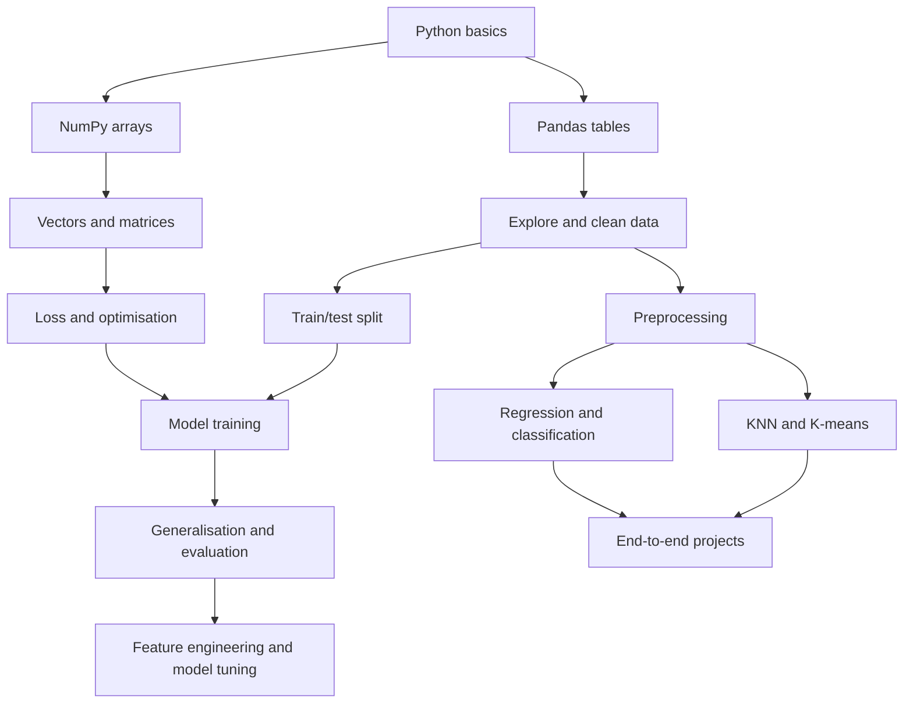

# Learning Roadmap

This roadmap follows prerequisites rather than treating ML algorithms as an isolated list.

## Pass 1 — Foundations
| Stage | Learn | Completion test |
|---|---|---|
| 00 | AI vs ML, data, features, targets, model, training and inference | Explain a house-price example from row to prediction |
| 01 | Python basics, functions, collections, files and errors | Write a small script that loads, validates and transforms values |
| 02 | NumPy arrays, shapes, broadcasting and vectorisation | Predict the shape/result of basic array operations |
| 03 | Pandas tables, missing data, grouping and train target separation | Load a CSV and explain X and y |
| 04 | Visualisation and exploratory analysis | Explain what a histogram and scatter plot do and do not show |
| 05 | Algebra, vectors, matrices, slope, derivatives and distance | Calculate a dot product and explain a gradient |
| 06 | Descriptive statistics and probability | Calculate mean, spread and a conditional probability |

## Pass 2 — Core ML
| Stage | Learn | Completion test |
|---|---|---|
| 07 | Training objectives, generalisation, overfitting, validation and leakage | Describe a valid train/validation/test setup |
| 08 | Imputation, encoding, scaling and pipelines | Fit transformations only on training data |
| 09 | Linear/logistic regression, KNN, trees, forests and Naive Bayes | Choose a baseline and justify metric/model choices |
| 10 | K-means, PCA and cluster evaluation | Explain why scaling changes distances and clusters |
| 11 | Regression/classification metrics and cross-validation | Compute precision/recall from a confusion matrix |
| 12 | Feature transformations, interactions and selection | Propose a feature without using future/target information |
| 13 | Baselines, tuning, learning curves and error analysis | Design an experiment before changing parameters |

## Pass 3 — Applied practice
| Stage | Learn | Completion test |
|---|---|---|
| 14 | Complete training/inference pipeline and model persistence | Train once, save, load and predict consistently |
| 15 | Ensembles, importance, drift, calibration, introductory NN/NLP | Describe purpose and limitations at a high level |
| 16 | Reproducible tabular/text/clustering projects | Explain design, failures and limitations of each project |
| 17 | Conceptual, numerical, code and scenario interview questions | Answer without relying on memorised phrases |
| 18 | Mixed practice and revision | Solve fresh questions and review weak topics |

## Dependency map

## Suggested pacing
- **Flexible pace:** one lesson per study session; spend another session coding if the examples are new.
- **Revision loop:** after 1 day, 1 week and 1 month, try to recreate the idea from memory.
- **Checkpoint rule:** if you cannot explain the previous lesson in plain English, revise it before moving forward.
- **Do not optimise for speed:** a working mental model and reproducible code matter more than ticking boxes quickly.
