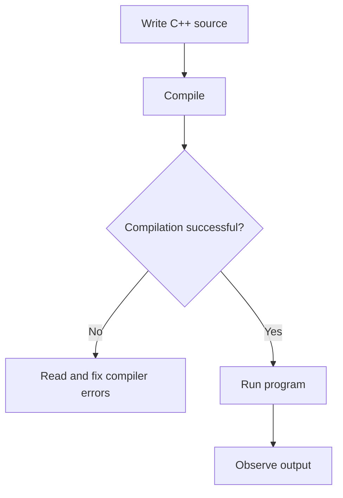

# Unit 0 — Get Ready: The C++ You Need Before OOP

**Prerequisites:** None. Start here if classes and objects feel confusing.
**Estimated time:** 2–3 hours.
**You will learn:** how a small C++ program runs, variables, conditions, loops, functions, arrays, strings, structs, and how values reach functions.

## Lesson 0.1 — What is a program?

A program is a list of instructions that tells the computer what to do. C++ source code is written in a text file, translated by a compiler into a program the computer can run, and then executed.

The basic flow is:



A **compile-time error** means the source code violates a language/compiler rule, so an executable is not produced. A **runtime problem** happens after execution starts. Output shown in a lesson is only valid if the code compiles and runs as written.

## Lesson 0.2 — The smallest useful C++ program

```cpp
#include <iostream>

int main() {
    std::cout << "Hello, C++!\n";
    return 0;
}
```

**Output**
```text
Hello, C++!
```

### Read it line by line
- The line with #include asks the preprocessor to make declarations from the input/output library available.
- The angle-bracket name iostream is a standard header that provides stream input/output tools such as std::cout.
- int means main returns an integer status to the operating system.
- main is where normal execution of this program begins.
- Parentheses after main hold its parameter list; here the list is empty.
- Curly braces mark the body of main.
- std::cout sends data to the terminal. The std:: prefix says the name belongs to C++'s standard-library namespace.
- The << operator sends the text to cout in this context.
- A string in double quotation marks is a string literal.
- The escape sequence \n means a newline.
- A semicolon ends this statement.
- return 0 reports successful completion. Reaching the end of main also returns zero in modern C++, but writing it explicitly is beginner-friendly.

## Lesson 0.3 — Variables and types

A variable is a named place to store a value of a particular type. The type tells C++ what kind of value is expected.

```cpp
#include <iostream>
#include <string>

int main() {
    int age = 20;
    double cgpa = 7.68;
    char grade = 'A';
    bool hasPassed = true;
    std::string name = "Riya";

    std::cout << name << '\n';
    std::cout << age << '\n';
    std::cout << cgpa << '\n';
    std::cout << grade << '\n';
    std::cout << std::boolalpha << hasPassed << '\n';
}
```

**Output**
```text
Riya
20
7.68
A
true
```

The declaration pattern is type, name, equals sign, initial value, semicolon. int stores integers; double stores fractional values approximately; char stores one character; bool stores true/false; std::string stores text. Use std::string rather than a character array for ordinary beginner text.

## Lesson 0.4 — Input, operators and conditions

```cpp
#include <iostream>

int main() {
    int marks{};
    std::cout << "Enter marks: ";
    std::cin >> marks;

    if (marks >= 40) {
        std::cout << "Pass\n";
    } else {
        std::cout << "Try again\n";
    }
}
```

**Example input**
```text
75
```

**Output**
```text
Enter marks: Pass
```

std::cin with >> reads a value typed by the user. The if condition is evaluated as true or false. The >= operator means “greater than or equal to.” If the condition is true, the first block runs; otherwise, the else block runs. Real input programs should also check whether reading succeeded before using the value.

Other useful operators: + addition, - subtraction, * multiplication, / division, % remainder for integers, == equality comparison, != not equal, && AND, || OR, ! NOT, and = assignment. Do not confuse assignment = with comparison ==.

## Lesson 0.5 — Loops

A loop repeats work. Use a for loop when a counter controls repetition and a while loop when repetition depends on a condition.

```cpp
#include <iostream>

int main() {
    int total = 0;
    for (int number = 1; number <= 4; ++number) {
        total += number;
    }
    std::cout << total << '\n';
}
```

**Output**
```text
10
```

Dry run: total starts at 0. The loop adds 1 (total 1), then 2 (total 3), then 3 (total 6), then 4 (total 10). number becomes 5, the condition 5 <= 4 is false, and the loop ends. ++number increases the counter by one. total += number is shorthand for total = total + number.

## Lesson 0.6 — Functions, parameters and return values

A function is a named reusable piece of work. A parameter is a named input to the function. A return value is the result sent back to the caller.

```cpp
#include <iostream>

int add(int a, int b) {
    return a + b;
}

int main() {
    int answer = add(3, 4);
    std::cout << answer << '\n';
}
```

**Output**
```text
7
```

Read the definition from left to right: int is the result type; add is the name; int a and int b are parameters; the body returns a + b. The call add(3, 4) sends 3 into a and 4 into b. The function returns 7, which is stored in answer. A void function performs an action without returning a value.

## Lesson 0.7 — Arrays and strings

An array stores a fixed number of elements of the same type. Its indexes start at zero. A string stores text.

```cpp
#include <iostream>
#include <string>

int main() {
    int marks[3] = {80, 90, 70};
    std::string name = "Aman";
    std::cout << name << '\n';
    std::cout << marks[0] << ' ' << marks[1] << ' ' << marks[2] << '\n';
}
```

**Output**
```text
Aman
80 90 70
```

marks[0] is the first element, marks[1] the second, and marks[2] the third. Accessing marks[3] would be out of bounds and causes undefined behaviour in ordinary C++ arrays.

## Lesson 0.8 — struct and passing data to functions

A struct groups multiple related values under one type. It is a useful bridge to classes.

```cpp
#include <iostream>
#include <string>

struct Student {
    std::string name;
    int marks;
};

void printStudent(Student student) {
    std::cout << student.name << ": " << student.marks << '\n';
}

int main() {
    Student s{"Mira", 91};
    printStudent(s);
}
```

**Output**
```text
Mira: 91
```

The function receives the Student by value, so it gets its own copy of the struct. Changing that copy would not change the original. Later, we will learn references, which let a function work with an existing object without copying it. Do not worry about references yet.

## Common beginner mistakes
- Forgetting a semicolon after a statement or struct/class definition.
- Writing = when you meant ==.
- Using an uninitialized local variable.
- Accessing an array index that does not exist.
- Expecting a function's returned value to print automatically.
- Using a variable outside the block where it was declared.
- Writing cout instead of std::cout when using no using-directive.
- Thinking that code comments change how the program executes.

## Practice — try before reading the answers

### Questions
1. What is the difference between int and std::string?
2. What is the difference between = and ==?
3. Predict the output of this program:

```cpp
int x = 3;
x = x + 2;
std::cout << x << '\n';
```

4. Write a function square(int x) that returns x multiplied by itself.
5. Write a loop that prints the numbers 1 through 5.
6. Debug: why does this not compile?

```cpp
int main() {
    std::cout << "Hi"
}
```

**Hints:** Check the statement terminator; include iostream and qualify std::cout when you need it.

### Answers
1. int stores an integer value; std::string stores text.
2. = assigns a value; == compares two values.
3. Output is 5.
4. One solution: `int square(int x) { return x * x; }`
5. One solution: `for (int i = 1; i <= 5; ++i) std::cout << i << '\\n';`
6. The output statement is missing a semicolon, and the full program also needs iostream plus std::cout or an appropriate namespace declaration.

## Quick revision
- A compiler translates source code into a runnable program.
- main is the normal entry point.
- Variables store values; types describe those values.
- if/else chooses between paths; loops repeat work.
- Functions accept parameters and may return values.
- Arrays use zero-based indexes; strings store text.
- A struct groups several related fields.

## Connection to Unit 1
You now know enough C++ to write small programs. Next we will see why keeping every student's information in unrelated variables becomes difficult and how OOP offers a way to organize it.

---
[Course home](../README.md) · [Setup and run examples](../SETUP-AND-RUN.md) · [Next: Unit 1 — Why OOP? →](../Unit-01-Why-Do-We-Need-OOP/README.md)
