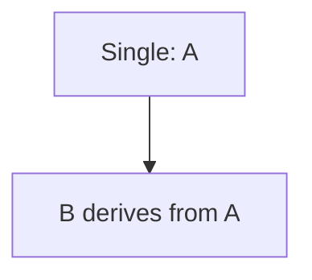
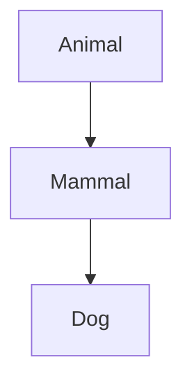
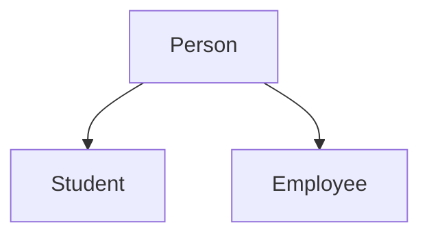
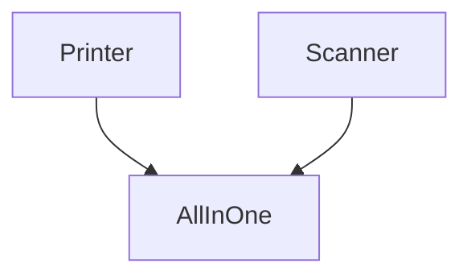
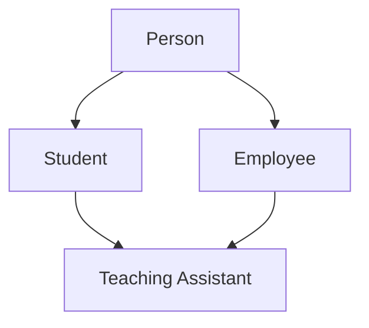

# Unit 8 — Inheritance: Building Related Types

**Prerequisite:** Classes, member functions, access specifiers and constructors (Units 2–5).
**Estimated time:** 2–3 hours.

## 1. Why inheritance?

Imagine many classes need the same information: a person's name. Student needs a roll number, and Employee needs an employee ID. We could duplicate the name field and common functions, but duplicated code can drift apart. Inheritance lets a new class use members of a base class and add or replace behaviour.

Inheritance should describe a real **is-a** relationship: a Student is a Person. A Person is not a Student. A Car has an Engine, so a Car should normally *contain/use* an Engine rather than inherit from it.

## 2. Base and derived class

```cpp
#include <iostream>
#include <string>
#include <utility>

class Person {
protected:
    std::string name;
public:
    explicit Person(std::string n) : name(n) {}

    void introduce() const {
        std::cout << "Name: " << name << '\n';
    }
};

class Student : public Person {
private:
    int roll;
public:
    Student(std::string n, int r) : Person(n), roll(r) {}

    void showRoll() const {
        std::cout << "Roll: " << roll << '\n';
    }
};

int main() {
    Student s("Riya", 21);
    s.introduce();
    s.showRoll();
}
```

**Output**
```text
Name: Riya
Roll: 21
```

Person is the base class. Student is the derived class. The public keyword in public Person states the inheritance access mode. Student inherits the public introduce() method and adds its own roll field and showRoll() method.

protected is introduced here because derived classes often need access to selected base state. It is not directly public to ordinary callers.

## 3. How to read Student(std::string n, int r) : Person(n), roll(r)

- Student is the constructor of the derived class.
- The parameters n and r receive the supplied name and roll number.
- The colon begins the member-initializer list.
- Person(n) calls the base-class constructor to initialize the Person part first.
- roll(r) initializes Student's own member.
- The constructor body is empty because both parts are already initialized.
- For a derived object, base construction happens before derived members/body; destruction happens in reverse order.

## 4. Types of inheritance



Single inheritance means one direct base class.



Multilevel inheritance: Dog derives from Mammal, which derives from Animal.



Hierarchical inheritance: more than one derived class shares one base class.

Multiple inheritance means a class has more than one direct base class:


Hybrid inheritance combines patterns, for example hierarchical and multiple inheritance in the same hierarchy. The names describe the shape of the hierarchy; they do not imply unrelated syntax rules.

## 5. public, protected and private inheritance

| Base member | public inheritance | protected inheritance | private inheritance |
|---|---|---|---|
| public | public | protected | private |
| protected | protected | protected | private |
| private | not directly accessible | not directly accessible | not directly accessible |

A class uses private inheritance by default; a struct uses public inheritance by default. The private members of a base subobject still exist, but derived code cannot access them directly. Derived code works with that state through accessible base functions.

Public inheritance is the usual choice for an is-a relationship, because callers should be able to use a derived object wherever the base type is expected.

## 6. Function overriding

Overriding happens when a derived class provides a matching implementation of an inherited virtual function. It is not the same as overloading, which uses different parameter lists.

```cpp
#include <iostream>

class Animal {
public:
    virtual void speak() const {
        std::cout << "Some animal sound\n";
    }
    virtual ~Animal() = default;
};

class Dog : public Animal {
public:
    void speak() const override {
        std::cout << "Bark\n";
    }
};

int main() {
    Dog dog;
    dog.speak();
}
```

**Output**
```text
Bark
```

virtual in the base permits runtime dispatch. override tells the compiler that the derived function is meant to override a base virtual; if the signature doesn't match, compilation fails.

## 7. Multiple inheritance, ambiguity and the diamond problem

When two base classes contain members with the same name, a call can be ambiguous:
```cpp
#include <iostream>
struct Printer { void run() { std::cout << "Print\n"; } };
struct Scanner { void run() { std::cout << "Scan\n"; } };
struct Device : Printer, Scanner {};
int main() {
    Device d;
    d.Printer::run();
    d.Scanner::run();
    // d.run(); // compile-time ambiguity
}
```

**Output**
```text
Print
Scan
```

The scope-qualified calls select a specific base. The diamond issue goes further: if Student and Employee both inherit Person, and TeachingAssistant inherits both, the final object can contain two Person subobjects.



With virtual inheritance, the shared base appears as one virtual base subobject:
```cpp
struct Person { int id = 0; };
struct Student : virtual Person {};
struct Employee : virtual Person {};
struct TeachingAssistant : Student, Employee {};
```

Virtual inheritance solves shared-base duplication. It is different from a virtual function, which enables runtime dispatch.

## 8. When inheritance is not the right choice

Use composition when one class has/uses another. If a Car owns an Engine member, Car can ask Engine to start it. Deriving Car from Engine would say that a car is an engine, which is not true.

Deep inheritance hierarchies are harder to modify because derived classes depend on base-class behaviour. Before using inheritance, ask whether every derived object can honour the base contract.

## 9. Practical challenge — University Directory (intermediate/tough)

### Problem statement
Create a Person base class with a name and virtual describe() function. Create Student with a roll number and Employee with an employee ID. Then create TeachingAssistant inheriting from both Student and Employee. Ensure there is only one shared Person subobject through virtual inheritance, override describe(), and store objects using smart pointers to Person.

### Worked solution
```cpp
#include <iostream>
#include <memory>
#include <string>
#include <utility>
#include <vector>

class Person {
protected:
    std::string name;
public:
    explicit Person(std::string n) : name(n) {}
    virtual void describe() const {
        std::cout << "Person: " << name << '\n';
    }
    virtual ~Person() = default;
};

class Student : virtual public Person {
protected:
    int roll;
public:
    Student(std::string n, int r) : Person(n), roll(r) {}
    void describe() const override {
        std::cout << "Student: " << name << ", roll " << roll << '\n';
    }
};

class Employee : virtual public Person {
protected:
    int employeeId;
public:
    Employee(std::string n, int id) : Person(n), employeeId(id) {}
    void describe() const override {
        std::cout << "Employee: " << name << ", id " << employeeId << '\n';
    }
};

class TeachingAssistant : public Student, public Employee {
public:
    TeachingAssistant(std::string n, int r, int id)
        : Person(n), Student(n, r), Employee(n, id) {}

    void describe() const override {
        std::cout << "TA: " << name << ", roll " << roll
                  << ", employee id " << employeeId << '\n';
    }
};

int main() {
    std::vector<std::unique_ptr<Person>> people;
    people.push_back(std::make_unique<Student>("Asha", 11));
    people.push_back(std::make_unique<Employee>("Dev", 71));
    people.push_back(std::make_unique<TeachingAssistant>("Mira", 21, 81));

    for (const auto& person : people) person->describe();
}
```

**Output**
```text
Student: Asha, roll 11
Employee: Dev, id 71
TA: Mira, roll 21, employee id 81
```

### Walkthrough
- Person defines the shared name and virtual interface.
- Student and Employee virtually inherit Person.
- TeachingAssistant constructs the shared virtual Person base because the most-derived class is responsible for virtual-base initialization.
- The vector owns different concrete objects through unique_ptr<Person>.
- A call to describe() dispatches to the concrete object.
- The virtual destructor lets the right derived destructor run when a pointer to Person owns a derived object.

**Stretch task:** add ResearchAssistant. Decide whether it is a Student, Employee or both before writing inheritance syntax.

## 10. Common mistakes
- Inheriting only to reuse code even though the is-a relationship is false.
- Forgetting that a derived constructor must initialize its bases.
- Expecting derived code to access private base members directly.
- Confusing function hiding with overriding.
- Forgetting virtual on the base method.
- Confusing virtual inheritance with virtual functions.
- Deleting a derived object through a non-virtual base destructor.

## 11. End-of-unit interview questions and answers

**Q1. What is inheritance?**  
A language feature that lets a derived class reuse and extend a base-class interface/state when the relationship is appropriate.

**Q2. What is the difference between base and derived class?**  
The base provides a more general type; the derived class adds or specializes features.

**Q3. What are the main forms of inheritance?**  
Single, multilevel, multiple, hierarchical and hybrid describe the shape of a class hierarchy.

**Q4. What is protected?**  
An access level mainly intended to let the class and eligible derived-class implementations use members without making them public to ordinary callers.

**Q5. What is the diamond problem?**  
A derived class inherits the same base through two paths and may contain duplicate base subobjects. Virtual inheritance can share the base.

**Q6. What is the difference between virtual inheritance and virtual functions?**  
Virtual inheritance changes whether a common base subobject is shared. Virtual functions control runtime method dispatch.

**Q7. What does override do?**  
It makes the compiler check that a derived method is actually overriding a base virtual function.

**Q8. Why should a polymorphic base have a virtual destructor?**  
So deletion through a base pointer correctly destroys the derived object.

**Q9. Composition vs inheritance?**  
Composition models has-a/uses-a. Public inheritance models a valid is-a relationship with substitutability.

**Q10. What is object slicing?**  
Copying a derived object into a base object by value loses the derived portion; use pointer/reference when polymorphism is intended.

## Quick revision and next step
Inheritance organizes related types, but it does not by itself guarantee different behaviour. Next, Unit 9 connects inheritance with polymorphism and explains how virtual calls select the right function at runtime.

## Additional practice — inheritance checkpoint

1. **Easy:** In Student : public Person, which is the base and which is derived?
2. **Easy:** Does derived code directly access a private base field?
3. **Beginner coding:** Create a Vehicle base class with a public method start() and a Car class that publicly inherits it.
4. **Beginner coding:** Add an Employee type alongside Student, both deriving from Person.
5. **Output prediction:**

```cpp
#include <iostream>
struct Base { virtual void show() const { std::cout << "Base"; } };
struct Child : Base { void show() const override { std::cout << "Child"; } };
int main() { Child c; Base& b = c; b.show(); }
```

6. **Debugging:** A derived class attempts to access a private base member directly. Explain the compiler error and name two proper alternatives.

### Hints and answers
1. Person is the base; Student is the derived class.
2. No. The base subobject exists, but its private member is not directly accessible by derived code.
3. Define Vehicle with start(); define class Car : public Vehicle {}; then call start() on a Car object.
4. Declare both with public inheritance and a constructor that initializes Person.
5. Output: Child, because show() is virtual and the dynamic object is Child.
6. Use an accessible protected/public base function or redesign which data/methods belong in the base; do not simply expose every field.

---
[← Previous: Unit 7](../Unit-07-Abstraction/README.md) · [Course home](../README.md) · [Next: Unit 9 — Polymorphism →](../Unit-09-Polymorphism/README.md)
