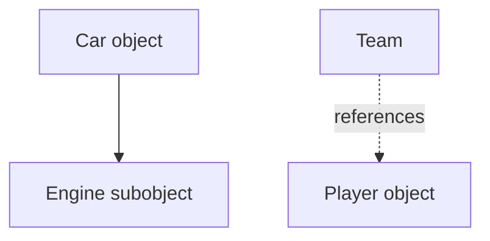

# Lesson 10.2 — Association, Aggregation and Composition

## Why learn object relationships?
A program often contains objects that cooperate. A Student may be enrolled in a Course; a Department may refer to several Teachers; a Car may contain an Engine. Choosing how objects relate affects ownership, lifetime and how easy the program is to change.

## Association
Association means objects are connected or communicate. A student may refer to a course, and a course may refer to students. The exact lifetime relationship depends on the model.

## Aggregation
Aggregation usually describes a whole that refers to parts which can exist independently. For example, a team may refer to players who can exist outside that team. In C++, the relationship might be represented by references, non-owning pointers or IDs; documentation must make the ownership rule clear.

## Composition
Composition describes a whole that owns its component parts, with the parts' lifetime tied to the whole. For a Car containing an Engine by value, the Engine subobject is constructed with the Car and destroyed with it.



The solid ownership-like connection illustrates composition; the dotted reference illustrates a non-owning association/aggregation-style relationship. Diagrams are conceptual; precise ownership should be documented in code.

## Composition code example

```cpp
#include <iostream>
#include <string>
#include <utility>

class Engine {
public:
    void start() const { std::cout << "Engine started\n"; }
};

class Car {
private:
    Engine engine;
    std::string model;
public:
    explicit Car(std::string name) : model(name) {}
    void start() const {
        std::cout << model << ": ";
        engine.start();
    }
};

int main() {
    Car car("Civic");
    car.start();
}
```

**Output**
```text
Civic: Engine started
```

Car has an Engine. It does not inherit from Engine, because a car is not an engine. The Engine member is built as part of Car's construction and cleaned up as part of Car's destruction.

## Association by reference

```cpp
#include <iostream>
#include <string>

class Course {
public:
    std::string title;
    explicit Course(std::string t) : title(t) {}
};

class Student {
    std::string name;
    const Course& course; // observes a course owned elsewhere
public:
    Student(std::string n, const Course& c) : name(n), course(c) {}
    void print() const {
        std::cout << name << " studies " << course.title << '\n';
    }
};

int main() {
    Course dataStructures("Data Structures");
    Student s("Riya", dataStructures);
    s.print();
}
```

**Output**
```text
Riya studies Data Structures
```

Student does not own the Course; it stores a reference to an existing Course. Therefore, the Course must outlive the Student. Storing references creates lifetime obligations, so use them only when the ownership relationship is clear.

## Composition vs inheritance

- “Car has an Engine” suggests composition.
- “Dog is an Animal” may justify public inheritance, if Dog honours the Animal contract.
- “Student attends Course” is a relationship/association, not usually inheritance.

Do not use inheritance merely because two classes share a field or a few lines of code.

## Practical challenge — Library and Books (intermediate)

Create a Library that stores a collection of Book objects by value. The library owns those stored books for the lifetime of the collection. Add two books and print them. Then explain how the design would change if books were owned by a separate system and the library only referred to them.

```cpp
#include <iostream>
#include <string>
#include <vector>

class Book {
    std::string title;
public:
    explicit Book(std::string t) : title(t) {}
    void print() const { std::cout << title << '\n'; }
};

class Library {
    std::vector<Book> books; // Library owns its stored Book values
public:
    void addBook(const Book& book) { books.push_back(book); }
    void printBooks() const {
        for (const Book& book : books) book.print();
    }
};

int main() {
    Library lib;
    lib.addBook(Book("C++ Primer"));
    lib.addBook(Book("Clean Code"));
    lib.printBooks();
}
```

**Output**
```text
C++ Primer
Clean Code
```

This demonstrates value ownership through a vector. If the Library must refer to Book objects owned elsewhere, the design must document their lifetime and use non-owning references/pointers or stable identifiers instead.

## Interview questions
1. **What is association?** A relationship/communication link between objects.
2. **What is composition?** A whole owns its component objects as part of its design/lifetime.
3. **Aggregation vs composition?** Aggregated parts can exist independently; composed parts' lifetime is tied to the owning whole in the model.
4. **Is a Car an Engine?** No; a Car has an Engine, so composition is usually appropriate.
5. **What is the risk of a non-owning reference?** The referenced object must outlive the reference's use.
6. **Why prefer composition over inheritance when sharing behaviour?** Components can be reused without asserting an incorrect subtype relationship.

---
[← Previous lesson: this, static, const and friend](01-this-static-const-friend.md) · [Unit 10 overview](README.md) · [Next lesson: Copying, Memory and RAII →](03-copy-memory-raii.md)
