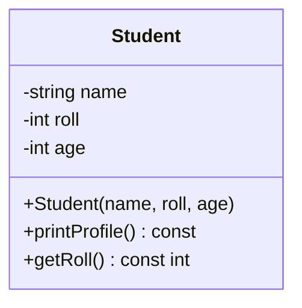

# Project 1 — Student Profile Manager

**Level:** Beginner | **Concepts:** class, object, private data, constructor, member functions, const getter.

## Requirements
- Store a student's name, roll number and age.
- Only provide safe public operations to display the profile.
- Reject age values below zero by using a simple default of zero for this beginner project.
- Create two different student objects and show that their data stays separate.

## Design


Student owns the three values. printProfile displays them; getRoll lets other code read a roll number without accessing the private field directly.

## Complete code
```cpp
#include <iostream>
#include <string>

class Student {
private:
    std::string name;
    int roll;
    int age;

public:
    Student(std::string studentName, int studentRoll, int studentAge)
        : name(studentName),
          roll(studentRoll),
          age(studentAge >= 0 ? studentAge : 0) {}

    void printProfile() const {
        std::cout << "Name: " << name
                  << ", Roll: " << roll
                  << ", Age: " << age << '\n';
    }

    int getRoll() const { return roll; }
};

int main() {
    Student first("Asha", 101, 20);
    Student second("Dev", 102, 19);
    first.printProfile();
    second.printProfile();
    std::cout << "First roll: " << first.getRoll() << '\n';
}
```

## Expected output
```text
Name: Asha, Roll: 101, Age: 20
Name: Dev, Roll: 102, Age: 19
First roll: 101
```

## Walkthrough
1. The constructor receives a name, roll number and age.
2. The initializer list fills each member before the constructor body (which is empty here).
3. The main function creates two independent objects.
4. Calling first.printProfile() prints the first object's data; it does not change second.
5. getRoll() returns a copy of the private integer so the caller can read it safely.

## Test cases
| Scenario | Example | Expected behaviour |
|---|---|---|
| Normal values | ("Asha",101,20) | Store and display values |
| Different object | ("Dev",102,19) | Display separate values |
| Negative age | ("Nia",103,-4) | Age becomes 0 by this project's documented fallback |
| Read roll | getRoll() | Returns the object's roll number |

## Extensions
- Validate that roll numbers are positive.
- Add a marks field and a function that reports pass/fail.
- Store a collection of Student objects in a vector.
- Change invalid-age handling from a fallback to an exception and compare the designs.

---
[Project index](../README.md) · [Next: Rectangle and Circle Calculator →](../02-Rectangle-Circle-Calculator/README.md)
