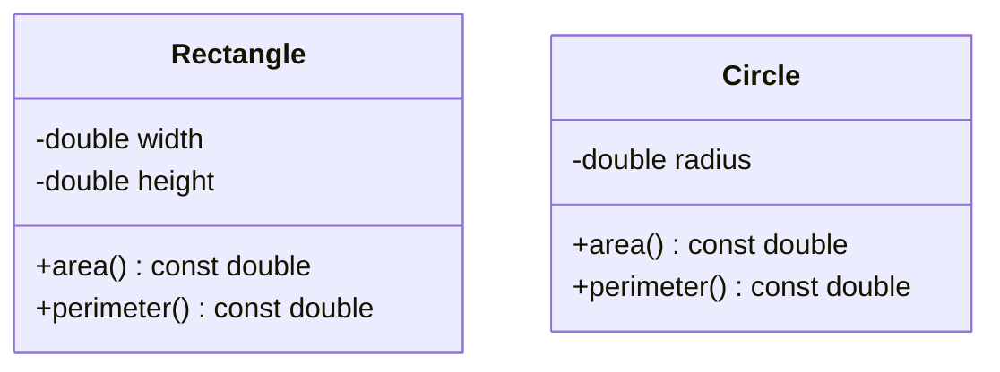

# Project 2 — Rectangle and Circle Calculator

**Level:** Beginner/intermediate | **Concepts:** classes, objects, methods, const, calculations and input validation.

## Requirements
Create separate Rectangle and Circle types. Each type calculates its area and perimeter. Dimensions must be positive; the example uses constructors that replace invalid dimensions with 0 to keep the first project easy. For a real API, consider returning a validation result or throwing an exception.

## Design


The classes are separate because the formulas differ. We will later use a shared Shape interface when polymorphic behaviour is needed.

## Complete code
```cpp
#include <iomanip>
#include <iostream>

class Rectangle {
private:
    double width;
    double height;

public:
    Rectangle(double w, double h)
        : width(w > 0 ? w : 0),
          height(h > 0 ? h : 0) {}

    double area() const { return width * height; }
    double perimeter() const { return 2 * (width + height); }
};

class Circle {
private:
    double radius;
public:
    explicit Circle(double r) : radius(r > 0 ? r : 0) {}

    double area() const { return 3.141592653589793 * radius * radius; }
    double perimeter() const { return 2 * 3.141592653589793 * radius; }
};

int main() {
    Rectangle r(4, 3);
    Circle c(2);

    std::cout << std::fixed << std::setprecision(2);
    std::cout << "Rectangle area: " << r.area() << '\n';
    std::cout << "Rectangle perimeter: " << r.perimeter() << '\n';
    std::cout << "Circle area: " << c.area() << '\n';
    std::cout << "Circle perimeter: " << c.perimeter() << '\n';
}
```

## Expected output
```text
Rectangle area: 12.00
Rectangle perimeter: 14.00
Circle area: 12.57
Circle perimeter: 12.57
```

## Walkthrough
- The constructors store the dimensions after applying the project's simple positive-value rule.
- area() and perimeter() are const methods because they calculate results without modifying the object.
- Rectangle area is width × height; its perimeter is twice the sum of its dimensions.
- Circle area is pi × radius²; circumference is 2 × pi × radius.
- fixed and setprecision(2) ask the output stream to show two digits after the decimal point.

## Test cases
| Test | Expected |
|---|---|
| Rectangle(4,3) | area 12, perimeter 14 |
| Circle(2) | area/circumference approximately 12.57 |
| Circle(-1) | stored radius 0 under the documented fallback |
| Rectangle(0,5) | stored width 0, so area 0 |

## Extensions
- Replace fallback validation with an exception.
- Add square as a separate type.
- Create a shared Shape base class and rework the calculator using polymorphism in Project 7.

---
[← Previous: Student Profile Manager](../01-Student-Profile-Manager/README.md) · [Project index](../README.md) · [Next: Bank Account Management →](../03-Bank-Account-Management/README.md)
