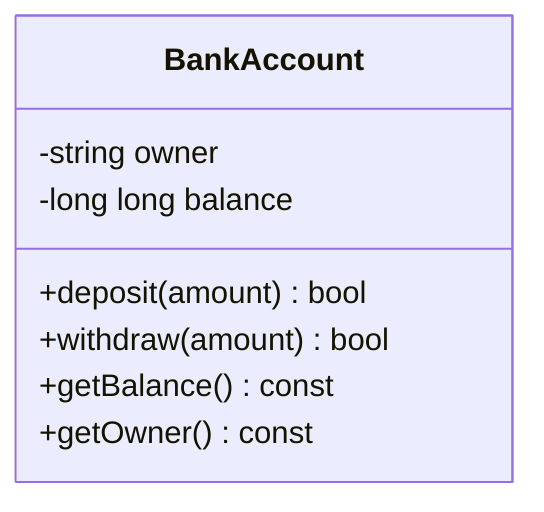

# Project 3 — Bank Account Management System

**Level:** Intermediate | **Concepts:** encapsulation, private state, constructor validation, invariants, return values.

## Requirements
Implement a bank account with an owner and balance. Deposits must be positive. Withdrawals must be positive and cannot exceed the balance. An operation returns true if it succeeds and false if rejected. The invariant is balance ≥ 0.

## Design


## Complete code
```cpp
#include <iostream>
#include <string>

class BankAccount {
private:
    std::string owner;
    long long balance; // integer currency minor units for this exercise

public:
    BankAccount(std::string accountOwner, long long openingBalance)
        : owner(accountOwner),
          balance(openingBalance >= 0 ? openingBalance : 0) {}

    bool deposit(long long amount) {
        if (amount <= 0) return false;
        balance += amount;
        return true;
    }

    bool withdraw(long long amount) {
        if (amount <= 0 || amount > balance) return false;
        balance -= amount;
        return true;
    }

    long long getBalance() const { return balance; }
    const std::string& getOwner() const { return owner; }
};

int main() {
    BankAccount account("Asha", 10000);
    std::cout << account.deposit(2500) << '\n';
    std::cout << account.withdraw(4000) << '\n';
    std::cout << account.withdraw(20000) << '\n';
    std::cout << account.deposit(-30) << '\n';
    std::cout << account.getOwner() << " balance: "
              << account.getBalance() << '\n';
}
```

## Expected output
```text
1
1
0
0
Asha balance: 8500
```

The stored integer units are chosen for learning; if representing rupees in paise, remember one rupee = 100 paise. A production account must define overflow limits, currency and transaction rules.

## Walkthrough
1. Initial balance is 10000.
2. Deposit 2500 succeeds: 12500.
3. Withdraw 4000 succeeds: 8500.
4. Withdraw 20000 fails, so the balance remains 8500.
5. Deposit -30 fails, so the balance still remains 8500.

## Test cases
- Valid positive deposit increases balance.
- Zero and negative deposits fail.
- Withdrawal equal to balance succeeds and leaves zero.
- Withdrawal greater than balance fails and leaves state unchanged.
- Negative opening balance follows the documented fallback and begins at zero.

## Extensions
- Add account IDs and a transaction record.
- Decide whether invalid construction should throw instead of using fallback.
- Separate transaction results from printing.
- Add unit tests for overflow boundaries.

---
[← Previous: Rectangle and Circle Calculator](../02-Rectangle-Circle-Calculator/README.md) · [Project index](../README.md) · [Next: College Result Management →](../04-College-Result-Management/README.md)
