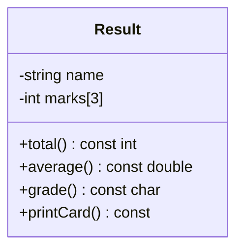

# Project 4 — College Result Management System

**Level:** Intermediate | **Concepts:** constructors, arrays, validation, calculations, const functions and invariants.

## Requirements
Represent a student's marks in three subjects. Reject a mark outside 0–100, calculate total and average, and assign a grade using these project rules: A ≥ 90, B ≥ 80, C ≥ 70, D ≥ 60, else F. Average is out of 100.

## Design


## Complete code
```cpp
#include <iomanip>
#include <iostream>
#include <stdexcept>
#include <string>

class Result {
private:
    std::string name;
    int marks[3];

public:
    Result(std::string studentName, int m1, int m2, int m3)
        : name(studentName), marks{m1, m2, m3} {
        for (int mark : marks) {
            if (mark < 0 || mark > 100) {
                throw std::invalid_argument("Each mark must be 0 to 100");
            }
        }
    }

    int total() const {
        return marks[0] + marks[1] + marks[2];
    }

    double average() const {
        return total() / 3.0;
    }

    char grade() const {
        const double a = average();
        if (a >= 90) return 'A';
        if (a >= 80) return 'B';
        if (a >= 70) return 'C';
        if (a >= 60) return 'D';
        return 'F';
    }

    void printCard() const {
        std::cout << "Result: " << name << '\n'
                  << "Total: " << total() << "/300\n"
                  << std::fixed << std::setprecision(2)
                  << "Average: " << average() << "\n"
                  << "Grade: " << grade() << '\n';
    }
};

int main() {
    try {
        Result r("Riya", 91, 84, 95);
        r.printCard();
    } catch (const std::invalid_argument& error) {
        std::cout << "Invalid result: " << error.what() << '\n';
    }
}
```

## Expected output
```text
Result: Riya
Total: 270/300
Average: 90.00
Grade: A
```

## Walkthrough
- The constructor initializes name and all three marks before checking the values.
- If any mark is invalid, it throws invalid_argument and no complete Result object is produced.
- total() adds the marks.
- average() divides by 3.0, not 3, so the result can contain a fractional part.
- grade() uses ordered if statements; the first true condition returns the matching grade.
- printCard() is const because it reads the object and prints a report without changing the student's result.
- main catches invalid_argument so invalid marks can be reported rather than causing an uncaught exception.

## Test cases
| Marks | Expected average | Grade |
|---|---:|---|
| 100,100,100 | 100.00 | A |
| 90,90,90 | 90.00 | A |
| 80,80,80 | 80.00 | B |
| 0,0,0 | 0.00 | F |
| 101,80,70 | Constructor throws | Invalid result message |

## Extensions
- Add subjects with names and use vector.
- Add pass/fail rules per subject as well as overall grade.
- Separate grade policy from result storage.
- Write tests for exact grade boundaries 59, 60, 69, 70, etc.

---
[← Previous: Bank Account Management](../03-Bank-Account-Management/README.md) · [Project index](../README.md) · [Next: Library Management →](../05-Library-Management/README.md)
