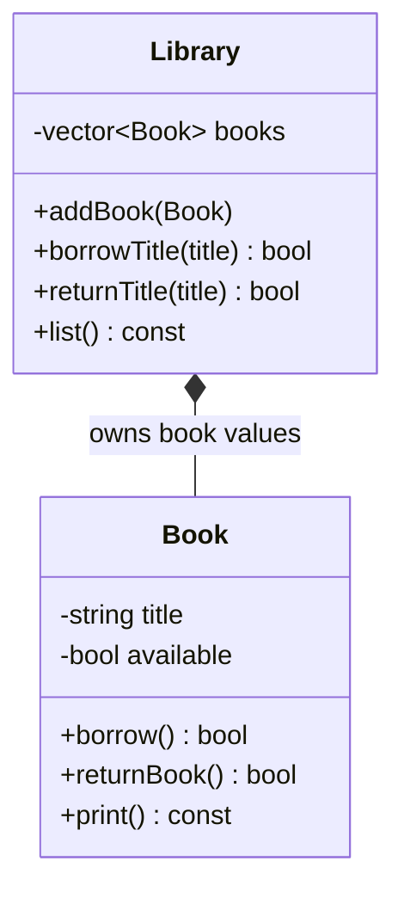

# Project 5 — Library Management System

**Level:** Intermediate | **Concepts:** encapsulation, object state, composition, collections and validation.

## Requirements
A library holds books. Each book has a title and can be available or borrowed. Support adding books, borrowing by title, returning by title and listing all books. Keep availability private. This teaching version compares exact titles and stores books by value inside Library, so Library owns the stored Book objects.

## Design


## Complete code
```cpp
#include <iostream>
#include <string>
#include <utility>
#include <vector>

class Book {
private:
    std::string title;
    bool available = true;
public:
    explicit Book(std::string t) : title(std::move(t)) {}

    const std::string& getTitle() const { return title; }

    bool borrow() {
        if (!available) return false;
        available = false;
        return true;
    }

    bool returnBook() {
        if (available) return false;
        available = true;
        return true;
    }

    void print() const {
        std::cout << title << " - "
                  << (available ? "Available" : "Borrowed") << '\n';
    }
};

class Library {
private:
    std::vector<Book> books;
public:
    void addBook(Book book) {
        books.push_back(std::move(book));
    }

    bool borrowTitle(const std::string& title) {
        for (Book& book : books) {
            if (book.getTitle() == title) return book.borrow();
        }
        return false;
    }

    bool returnTitle(const std::string& title) {
        for (Book& book : books) {
            if (book.getTitle() == title) return book.returnBook();
        }
        return false;
    }

    void list() const {
        for (const Book& book : books) book.print();
    }
};

int main() {
    Library library;
    library.addBook(Book("C++ Primer"));
    library.addBook(Book("Clean Code"));

    std::cout << "Borrowed: " << library.borrowTitle("C++ Primer") << '\n';
    std::cout << "Borrowed again: " << library.borrowTitle("C++ Primer") << '\n';
    std::cout << "Returned: " << library.returnTitle("C++ Primer") << '\n';
    library.list();
}
```

## Expected output
```text
Borrowed: 1
Borrowed again: 0
Returned: 1
C++ Primer - Available
Clean Code - Available
```

## Walkthrough
- Each Book keeps its own availability state private.
- borrow() changes availability only if the book is currently available.
- returnBook() changes availability only if the book is currently borrowed.
- Library owns a vector of Book values and searches by title.
- Returning false means a title was missing or the operation was not valid in the current state.
- std::move(book) transfers the temporary argument into the vector; it is a cast that makes move operations eligible.

## Test cases
- Borrow an existing available book: true.
- Borrow the same book twice: second call false.
- Return a currently borrowed book: true.
- Return an already available book: false.
- Borrow a missing title: false.

## Extensions
- Give every book a unique ID so duplicate titles are allowed.
- Add borrowers and due dates.
- Store books in a map keyed by ID.
- Decide whether Library should own books by value or reference books managed elsewhere.

---
[← Previous: College Result Management](../04-College-Result-Management/README.md) · [Project index](../README.md) · [Next: Employee Payroll →](../06-Employee-Payroll/README.md)
