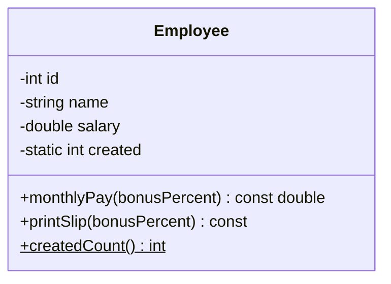

# Project 6 — Employee Payroll System

**Level:** Intermediate | **Concepts:** constructors, private fields, const methods, static data, calculations and validation.

## Requirements
Represent an employee with ID, name and monthly base salary. A function returns a bonus as a percentage of base salary. Keep salary private and reject negative salary by using a documented fallback of zero. Track how many Employee objects were constructed in a static counter.

## Design


## Complete code
```cpp
#include <iomanip>
#include <iostream>
#include <string>

class Employee {
private:
    int id;
    std::string name;
    double salary;
    inline static int created = 0;

public:
    Employee(int employeeId, std::string employeeName, double baseSalary)
        : id(employeeId),
          name(employeeName),
          salary(baseSalary >= 0 ? baseSalary : 0) {
        ++created;
    }

    double monthlyPay(double bonusPercent) const {
        if (bonusPercent < 0) return salary;
        return salary + salary * bonusPercent / 100.0;
    }

    void printSlip(double bonusPercent) const {
        std::cout << id << " - " << name
                  << " - " << monthlyPay(bonusPercent) << '\n';
    }

    static int createdCount() { return created; }
};

int main() {
    Employee a(101, "Asha", 30000);
    Employee b(102, "Dev", 25000);

    std::cout << std::fixed << std::setprecision(2);
    a.printSlip(10);
    b.printSlip(5);
    std::cout << "Objects constructed: " << Employee::createdCount() << '\n';
}
```

## Expected output
```text
101 - Asha - 33000.00
102 - Dev - 26250.00
Objects constructed: 2
```

## Walkthrough
- The constructor initializes ID, name and salary, then increases created.
- created is static, so both objects share the same counter.
- monthlyPay() reads salary and computes a bonus; it doesn't change the employee and is therefore const.
- createdCount() is static and is called as Employee::createdCount() without an object.
- The bonus formula is base plus base × percent / 100.

The example is intentionally simplified; it does not handle tax, overtime, currency precision, overflow or employment rules.

## Test cases
| Base | Bonus percent | Expected pay |
|---:|---:|---:|
| 30000 | 10 | 33000 |
| 25000 | 5 | 26250 |
| 40000 | 0 | 40000 |
| 20000 | -5 | 20000 by this example's policy |
| -100 | 5 | base becomes 0 by constructor policy |

## Extensions
- Use a validated result instead of silently replacing invalid values.
- Add hourly employees with overtime.
- Define a common EmployeePayPolicy interface to demonstrate runtime polymorphism.

---
[← Previous: Library Management](../05-Library-Management/README.md) · [Project index](../README.md) · [Next: Shape Polymorphism →](../07-Shape-Polymorphism/README.md)
