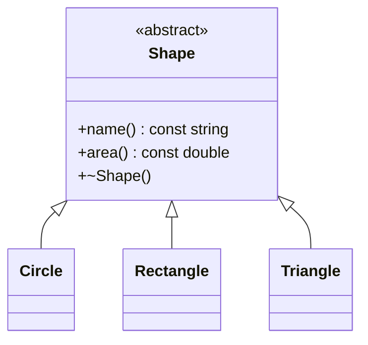

# Project 7 — Shape Drawing and Area Report

**Level:** Intermediate/tough | **Concepts:** abstract base class, pure virtual functions, overriding, dynamic dispatch, virtual destructors and smart pointers.

## Requirements
Define one Shape interface. Circle, Rectangle and Triangle should provide their own name and area implementation. Store all of them in one collection and print every shape without using if/else to distinguish concrete types.

## Design


## Complete code
```cpp
#include <iomanip>
#include <iostream>
#include <memory>
#include <string>
#include <vector>

class Shape {
public:
    virtual std::string name() const = 0;
    virtual double area() const = 0;
    virtual ~Shape() = default;
};

class Circle : public Shape {
    double radius;
public:
    explicit Circle(double r) : radius(r > 0 ? r : 0) {}
    std::string name() const override { return "Circle"; }
    double area() const override { return 3.141592653589793 * radius * radius; }
};

class Rectangle : public Shape {
    double width, height;
public:
    Rectangle(double w, double h)
        : width(w > 0 ? w : 0), height(h > 0 ? h : 0) {}
    std::string name() const override { return "Rectangle"; }
    double area() const override { return width * height; }
};

class Triangle : public Shape {
    double base, height;
public:
    Triangle(double b, double h)
        : base(b > 0 ? b : 0), height(h > 0 ? h : 0) {}
    std::string name() const override { return "Triangle"; }
    double area() const override { return base * height / 2.0; }
};

int main() {
    std::vector<std::unique_ptr<Shape>> shapes;
    shapes.push_back(std::make_unique<Circle>(2));
    shapes.push_back(std::make_unique<Rectangle>(3, 4));
    shapes.push_back(std::make_unique<Triangle>(4, 3));

    std::cout << std::fixed << std::setprecision(2);
    for (const auto& shape : shapes) {
        std::cout << shape->name() << ": " << shape->area() << '\n';
    }
}
```

## Expected output
```text
Circle: 12.57
Rectangle: 12.00
Triangle: 6.00
```

## Walkthrough
- Shape describes operations all concrete shapes promise to implement.
- A pure virtual function is declared with = 0; Shape cannot be directly instantiated.
- Each concrete class overrides name() and area().
- unique_ptr owns each shape; the collection can contain different derived types through one Shape type.
- The virtual call runs the implementation of the actual object.
- The virtual base destructor is essential for safe deletion through a Shape pointer.

## Test cases
- Circle radius 2: area approximately 12.57.
- Rectangle 3 by 4: area 12.
- Triangle base 4, height 3: area 6.
- Negative dimensions become zero under the simplified validation rule.
- Add another concrete Shape and verify that the loop does not need to change.

## Extensions
- Add perimeter() to the abstract interface.
- Return validation errors rather than silently replacing negative values.
- Add a shape that uses composition, such as a polygon storing its vertices.

---
[← Previous: Employee Payroll](../06-Employee-Payroll/README.md) · [Project index](../README.md) · [Next: Multi-class Payroll →](../08-Multi-Class-Payroll-System/README.md)
