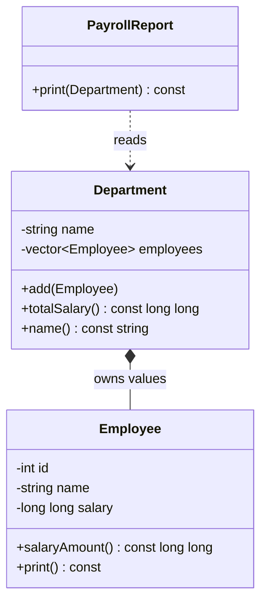

# Project 8 — Multi-Class Payroll System

**Level:** Intermediate/tough | **Concepts:** class responsibilities, composition, validation, collections, const accessors and separation of concerns.

## Requirements
Build a simplified payroll report from three collaborating classes:
- Employee stores an employee ID, name and salary.
- Department owns a collection of employees by value.
- PayrollReport prints department totals without changing employees.
Use salary in integer units for this exercise. Reject negative salary by using a documented fallback of zero. Keep each class focused on one responsibility.

## Design


Department owns its employee values through a vector. PayrollReport reads the department through const member functions. There is no inheritance requirement here: the relationship between a department and its employees is a has-many relationship.

## Complete code
```cpp
#include <iostream>
#include <string>
#include <utility>
#include <vector>

class Employee {
private:
    int id;
    std::string name;
    long long salary;

public:
    Employee(int employeeId, std::string employeeName, long long amount)
        : id(employeeId),
          name(std::move(employeeName)),
          salary(amount >= 0 ? amount : 0) {}

    long long salaryAmount() const { return salary; }

    void print() const {
        std::cout << id << " | " << name << " | " << salary << '\n';
    }
};

class Department {
private:
    std::string departmentName;
    std::vector<Employee> employees;

public:
    explicit Department(std::string name)
        : departmentName(std::move(name)) {}

    void add(Employee employee) {
        employees.push_back(std::move(employee));
    }

    long long totalSalary() const {
        long long total = 0;
        for (const Employee& employee : employees) {
            total += employee.salaryAmount();
        }
        return total;
    }

    const std::string& name() const { return departmentName; }

    void printEmployees() const {
        for (const Employee& employee : employees) employee.print();
    }
};

class PayrollReport {
public:
    void print(const Department& department) const {
        std::cout << "Department: " << department.name() << '\n';
        department.printEmployees();
        std::cout << "Total salary: " << department.totalSalary() << '\n';
    }
};

int main() {
    Department engineering("Engineering");
    engineering.add(Employee(1, "Asha", 50000));
    engineering.add(Employee(2, "Dev", 45000));
    engineering.add(Employee(3, "Riya", 48000));

    PayrollReport report;
    report.print(engineering);
}
```

## Expected output
```text
Department: Engineering
1 | Asha | 50000
2 | Dev | 45000
3 | Riya | 48000
Total salary: 143000
```

## Walkthrough
- Each Employee stores its own state and returns the salary through a const getter.
- Department stores Employee values in a vector and manages the collection.
- add() accepts an Employee value then moves it into the collection. This avoids raw owning pointers.
- totalSalary() loops over employees and sums their salaries.
- PayrollReport focuses on presentation: it asks Department for the information and does not modify payroll data.
- The output total is 50000 + 45000 + 48000 = 143000.

## Test cases
- Empty department total should be 0.
- Add one employee; total should equal that employee's salary.
- Add three employees; total should be sum of all salaries.
- Negative salary follows the documented fallback to zero.
- Calling print repeatedly must not change the total.

## Extensions
- Add a common PayPolicy interface for full-time and hourly employees.
- Add tax deductions as a separate policy.
- Write the report to a file using a file stream.
- Add validation for duplicate employee IDs.
- Add a unit test for a very large salary to think about integer overflow.

## Interview takeaway
A class should have a clear responsibility. Employee owns one employee's state; Department owns the employee collection; PayrollReport formats information. This separation keeps design changes localized and avoids a single class doing everything.

---
[← Previous: Shape Polymorphism](../07-Shape-Polymorphism/README.md) · [Project index](../README.md) · [Next: Unit 12 — Interview Prep →](../../Unit-12-Revision-and-Interview-Prep/README.md)
